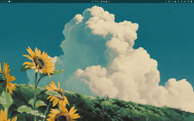

# Omadice

An [Omarchy](https://omarchy.org/) plugin for throwing a physics-driven 3D die across your desktop. Click the dice widget to throw; right-click it to open settings.

[](preview.gif)

## Install

The plugin repository has not been published yet.

## Usage

- Left-click the dice widget to throw a die.
- Left-click again while the die is moving to cancel and hide it.
- Right-click the widget to open settings.
- Adjust throw power from 50% to 150% with the slider.
- Choose **Normal**, **Theme**, or **Theme inverted** dice colors.

### Settings

Throw power and dice theme are saved in `~/.config/omarchy/shell.json`.

## Remove

```bash
omarchy plugin remove tibevdb.dice
```

This plugin was vibe coded with [OpenCode](https://opencode.ai/).
